# FeePulse — AI Cashflow Copilot for Independent Tutors

> **Live Production Application:** [https://feepulse.vercel.app](https://feepulse.vercel.app)  
> **One-Click Judge Demo:** Open the live link and click **"Explore Live Demo →"** (no sign-up or credentials required).

[](https://nextjs.org/)
[](https://react.dev/)
[](https://www.typescriptlang.org/)
[](https://supabase.com/)
[](https://groq.com/)
[](https://tailwindcss.com/)

---

## 1. Project Introduction

**FeePulse** is a dedicated financial copilot built specifically for independent tutors, home educators, and micro-coaching academies in India.

Independent tutors operate a high-trust, relationship-driven business. While generic accounting software (such as Tally, QuickBooks, or Zoho Books) caters to GST supply chains, inventory, and corporate double-entry ledgers, independent tutors face a different everyday operational struggle:

* Tutors juggle fee notes across physical notebooks, WhatsApp chats, and fragmented spreadsheets.
* Parents pay irregularly in unpredictable partial installments (e.g. ₹1,500 now, ₹1,000 two weeks later, ₹500 in cash).
* WhatsApp payment commitments (*"Sir, will pay next Tuesday"*) are easily forgotten, quietly slipping into uncollected bad debt.
* Meanwhile, fixed operating overheads (classroom rent, teacher honorariums, electricity) arrive on strict calendar deadlines.
* Tutors only realize a cash deficit after they are already short on rent day.

**FeePulse solves this by unifying fee tracking, installment accounting, WhatsApp promise tracking, and predictive 30/60/90-day cashflow runway into a single automated back-office workspace.**

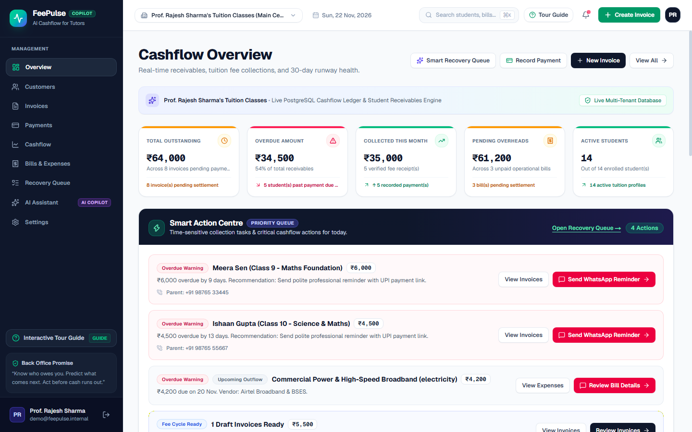

---

## 2. The Problem We Solve

| Traditional Tutor Workflow | The FeePulse Solution |
| :--- | :--- |
| **Pocket Notebooks & Spreadsheets:** Manually tracking who paid and who owes across 40–80 students. | **Unified Student & Fee Ledger:** Instant directory tracking enrolled students, batches, fee structures, and remaining balances in real time. |
| **Fragmented Partial Installments:** ₹2,000 paid on an ₹8,500 fee slip causes mental math errors and awkward disputes. | **Atomic Installment Accounting:** Every payment is recorded with integer paise precision and automatically adjusts invoice balances. |
| **Forgotten WhatsApp Promises:** Parents say *"will pay by the 10th"* and commitments slip past unnoticed. | **Smart Recovery Queue:** Overdue accounts are automatically ranked by an urgency score, factoring in overdue aging and broken promises. |
| **Awkward Payment Reminders:** Asking parents directly for money feels distasteful or aggressive. | **1-Click Pre-filled WhatsApp Links:** AI drafts polite, professional reminders with pre-filled `wa.me/` links that tutors review and send in 1 tap. |
| **Unexpected Cash Crises:** Finding out on the 1st of the month that student collections are insufficient for rent. | **Deterministic Cashflow Forecasting:** Proactive 30/60/90-day cash runway modeling upcoming fee cycles against scheduled overheads. |

---

## 3. Main Features & Exact Access Guide

FeePulse provides 10 core integrated modules. Every feature is functional and accessible from the sidebar and top navigation:

| Feature | Where to Access | What it Does | How to Use It |
| :--- | :--- | :--- | :--- |
| **Financial Dashboard** | `/` (*Overview*) | Real-time financial health cockpit showing total receivables, overdue aging, monthly collections, and pending overheads. | Open the app to view live KPI cards, interactive 30-day runway projection, and prioritized action items. |
| **Students & Batches** | `/customers` | Full student roster management with parent contacts, tuition batch/grade tags, monthly fees, and payment histories. | Click **Add Student**, fill name, grade, parent WhatsApp, and monthly fee. Click any student row to view their balance drawer. |
| **Invoices & Fee Slips** | `/invoices` | Multi-item tuition fee billing with draft/sent workflows, balance due calculations, and printable slips. | Click **Create Invoice**, choose a student, add line items (e.g. *Class 10 Maths Term 1*), set due date, and click **Issue Invoice**. |
| **Fee Collections & Receipts** | `/payments` | Record payments via UPI, Cash, Cheque, or Bank Transfer with atomic balance reconciliation and printable receipts. | Click **Record Payment**, pick the invoice, enter amount and payment mode/UTR, and print or download the verified receipt. |
| **Operational Expenses** | `/expenses` | Track coaching rent, assistant teacher salaries, electricity, and exam printing to prevent budget surprises. | Click **Add Expense**, enter vendor, category, amount, and due date. Mark as paid upon settlement. |
| **Cashflow Forecasting** | `/cashflow` | 30, 60, and 90-day deterministic cash roll-forward projecting daily balances, inflow cycles, and scheduled bills. | Toggle between 30D, 60D, and 90D views to review daily ending balances and early deficit risk warnings. |
| **What-If Scenario Simulator** | `/cashflow` (*Simulator Tab*) | Interactive stress-testing sandbox to model collection delays (e.g. 20% delayed payments) or unexpected expense spikes. | Open the **Scenario Simulator** tab, adjust sliders for collection rates or delayed dates, and compare outcomes against baseline. |
| **Smart Recovery Queue** | `/recovery-queue` | Ranks overdue accounts by urgency score (days overdue, balance amount, and broken payment promises). | Review top-ranked students, view past promise records, and click **Send WhatsApp Reminder** to follow up. |
| **AI Assistant & Scanner** | `/ai-assistant` | Multimodal scanner for receipts/bills, WhatsApp promise parser, and multi-tone reminder draft generator. | Upload an expense bill image or paste a WhatsApp chat snippet to extract structured amounts and dates for review. |
| **Academy Settings** | `/settings` | Configure tuition academy name, UPI ID for QR code fee collection, invoice prefix, and cash reserve targets. | Update business profile, enter your UPI handle (e.g. `academy@okhdfcbank`), and save preferences. |

### Feature Walkthrough with Application Screenshots

#### 1. Financial Dashboard & Health Cockpit (`/`)
Displays instant metrics calculated deterministically from active database records:
* **Total Outstanding:** Total unpaid fees across all enrolled students.
* **Overdue Amount:** Receivables that have crossed their payment due date.
* **Collected This Month:** Verified fee receipts recorded in the current calendar month.
* **Pending Overheads:** Unpaid operational bills due within the billing cycle.
* **Smart Action Center:** Highlighted top 3 urgent collections and upcoming overhead deadlines.

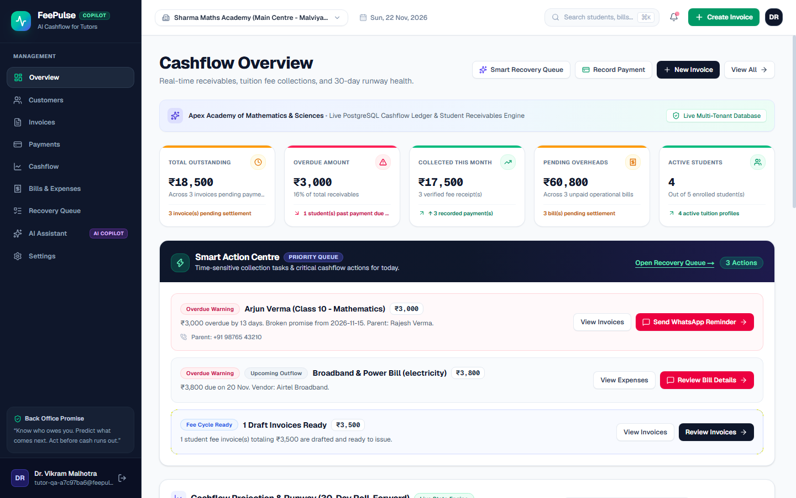

#### 2. Students & Tuition Batches (`/customers`)
Manage student batches (Class 9, 10, 11, 12), parent contact details, and fee structures. Search by student name, filter by batch or status, and open student profiles to view audit trails.

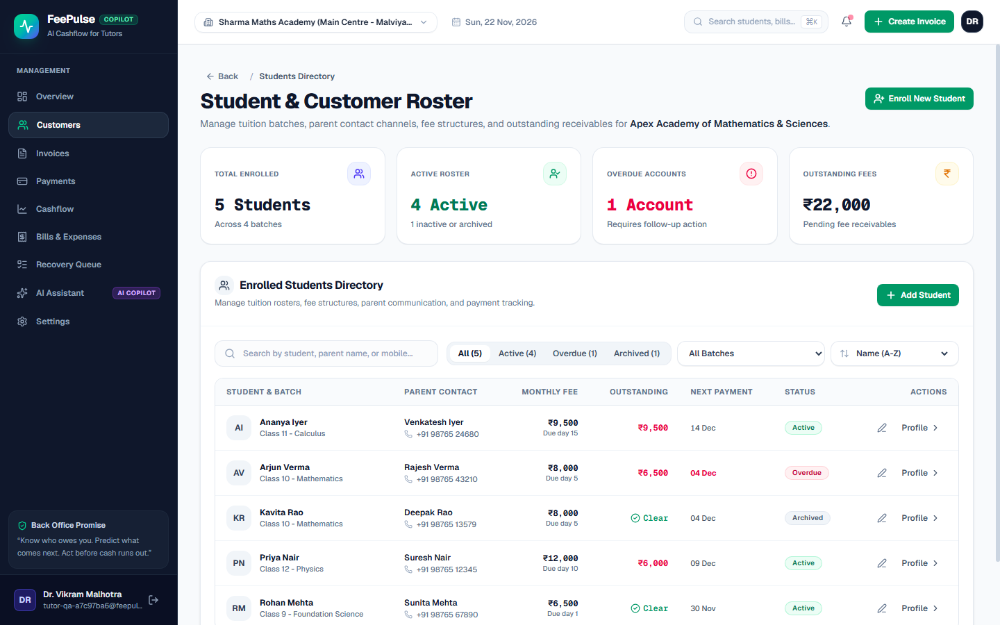

#### 3. Invoices & Printable Fee Slips (`/invoices`)
Generate multi-item tuition fee invoices. View balance due, mark invoices as sent, and generate print-ready invoice slips complete with student details and payment terms.

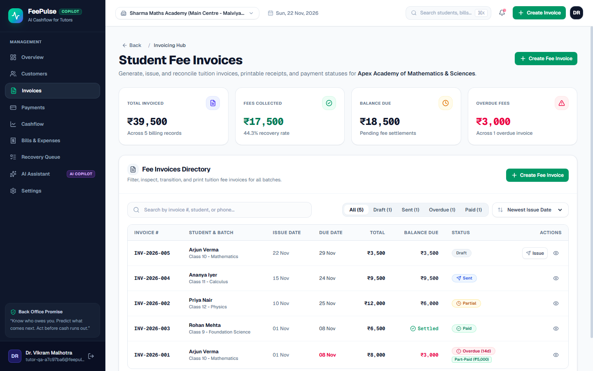
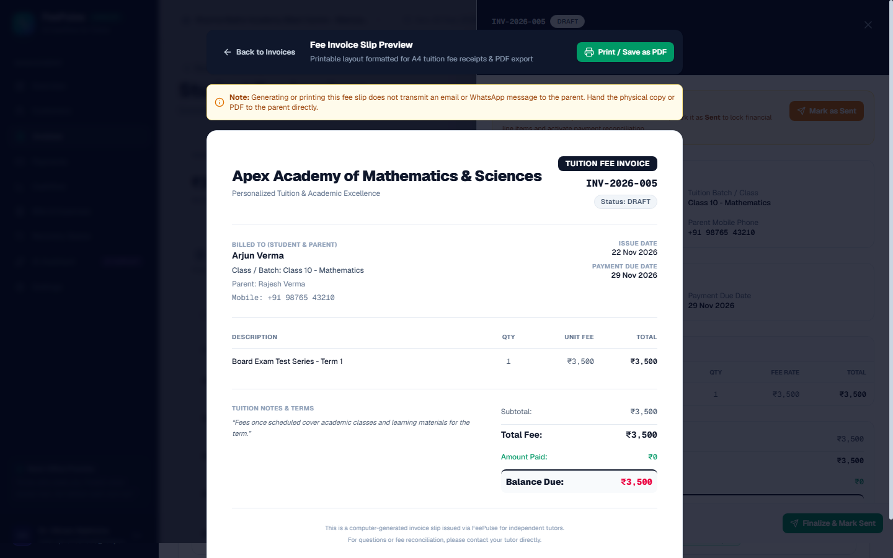

#### 4. Payments Ledger & Printable Receipts (`/payments`)
Record payments across UPI, Net Banking, Cash, and Cheque. Payments are protected by idempotency keys to prevent duplicate entries. View settlement slips with full parent and invoice metadata.

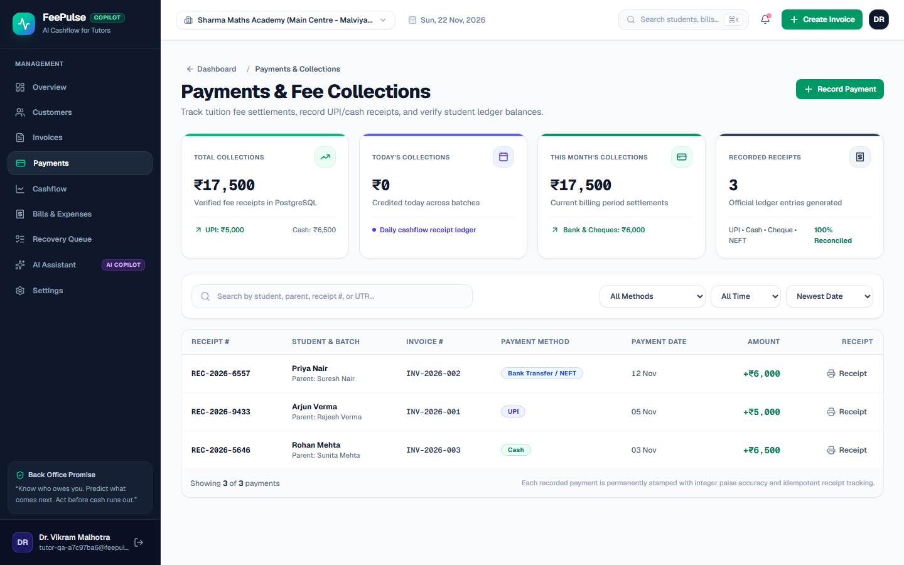
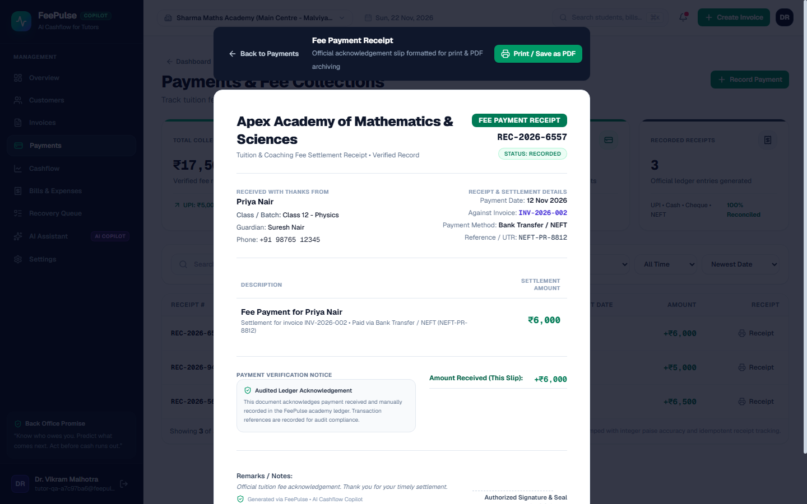

#### 5. Operational Bills & Expenses (`/expenses`)
Track recurring coaching center rent, faculty honorariums, utility bills, and printed question banks. Categorize expenses and review upcoming vs overdue bills.

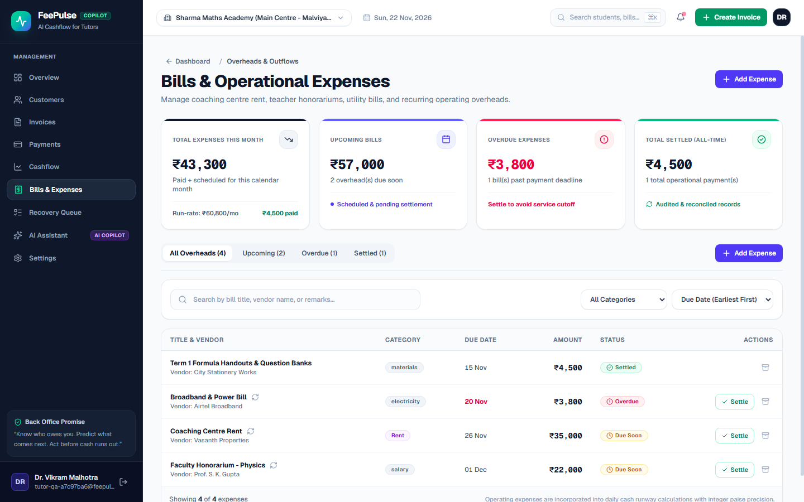

#### 6. Predictive Cashflow Forecasting & Runway (`/cashflow`)
Deterministic roll-forward projection combining fee collection cycles, confirmed promises, and fixed overheads. Visualizes daily cash balance over 30, 60, and 90 days with early deficit warnings.


#### 7. What-If Scenario Simulator (`/cashflow` -> Scenario Tab)
Adjust collection rates or introduce hypothetical emergency expenses to model alternative cash outcomes and evaluate required reserve buffers.

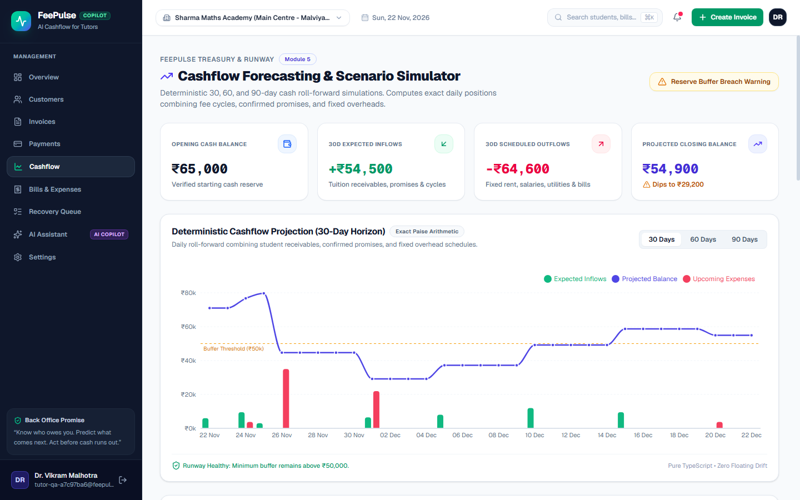

#### 8. Smart Recovery Queue (`/recovery-queue`)
Prioritizes collection efforts using an algorithm that weights overdue days, balance amount, and broken payment promises. Click **Send WhatsApp Reminder** to open pre-filled messages directly in WhatsApp.

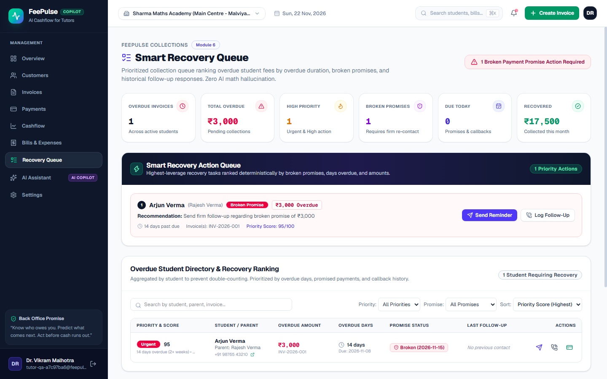

#### 9. AI Assistant & Document Scanner (`/ai-assistant`)
* **Document Scanner:** Multimodal Groq Vision extracts vendor names, amounts, invoice dates, and categories from paper receipts or UPI payment screenshots.
* **WhatsApp Promise Parser:** Extracts promised amounts and dates from unstructured WhatsApp messages (e.g. *"Will transfer 5000 tomorrow evening"*).
* **Payment Reminder Generator:** Drafts polite, standard, or firm reminders tailored to the student's overdue status.

> [!IMPORTANT]
> **Zero-Hallucination & Human-in-the-Loop Safeguard:** AI outputs never mutate financial balances directly. Tutors review and approve all extracted data before it is saved to the ledger.

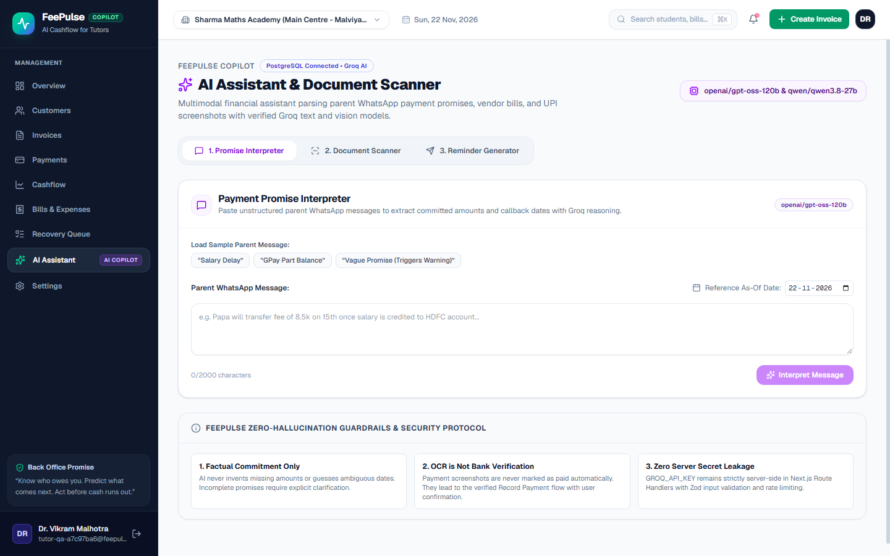

#### 10. Global Multi-Search & Command Palette (`⌘K` / `Ctrl+K`)
Instant search across 5 entity types: Students, Invoices, Receipts, Expenses, and Navigation Pages. Includes instant filter tabs, single-click search clear (`✕`), and keyboard navigation.

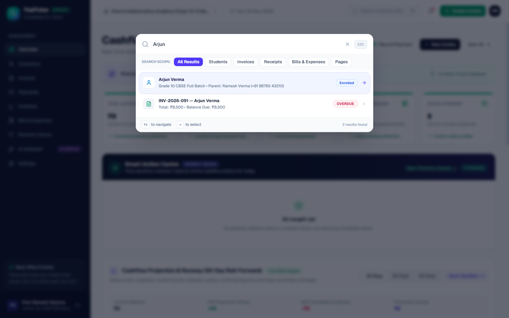

---

## 4. Quick 5-Step Demo Workflow

Experience the core FeePulse workflow in under 2 minutes:

1. **Open the Dashboard:** View the live financial cockpit, outstanding balances, and active priority queue.
2. **Add a Student:** Navigate to `/customers`, click **Add Student**, and enroll a new student with monthly fee details.
3. **Issue a Fee Invoice:** Go to `/invoices`, click **Create Invoice**, select the student, add tuition items, and set the due date.
4. **Record a Partial Payment:** Go to `/payments`, click **Record Payment**, choose the invoice, enter a partial amount (e.g. ₹3,000 on a ₹7,500 invoice), and notice the remaining balance update automatically.
5. **Inspect Cashflow & Recovery:** Open `/cashflow` to see the updated daily inflow schedule, then open `/recovery-queue` to see the remaining balance prioritized for follow-up.

---

## 5. Technology Stack

FeePulse is built using modern, production-grade technologies:

* **Frontend Framework:** Next.js 16.4.6 (App Router with Turbopack)
* **UI Library:** React 19.0.0
* **Language:** TypeScript 5 (Strict Mode enabled)
* **Styling & Design System:** Tailwind CSS 4 with custom fintech tokens
* **Database & Auth:** Supabase PostgreSQL 17 with Row-Level Security (RLS) and `@supabase/ssr`
* **Icons:** Lucide React
* **Data Validation:** Zod Schema Validation
* **AI Integration:** Groq Cloud API (Llama 3.3 70B Versatile & Qwen 2.5 72B Vision)
* **Deployment:** Vercel Production Platform (Edge CDN, Automated CI/CD)

---

## 6. Architecture & Financial Security Safeguards

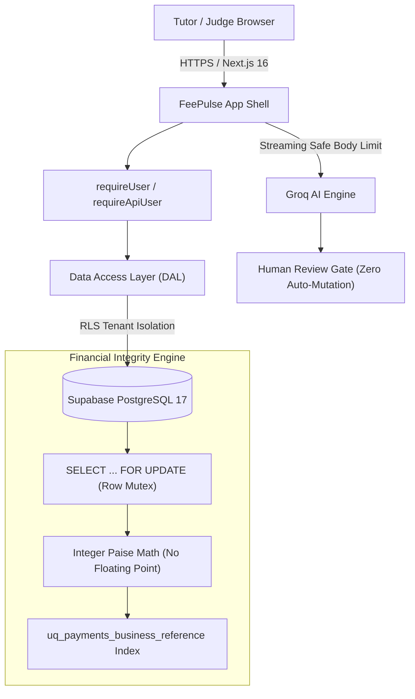

1. **ACID Row-Level Mutex Locking:** Concurrent payments on the same invoice are serialized at the database layer via `SELECT ... FOR UPDATE` locks, preventing negative balances and race conditions.
2. **Integer Paise Financial Precision:** All financial calculations use integer paise (`Math.round(amount * 100)`), eliminating JavaScript floating-point errors (`0.1 + 0.2 !== 0.3`).
3. **Durable Payment Idempotency:** Payments are bound to unique request idempotency keys and external UTR / Cheque references (`uk_payments_business_reference`), rejecting duplicate submissions.
4. **Strict Multi-Tenant RLS Isolation:** All database tables enforce Row-Level Security scoped to the authenticated user's `business_id`. Cross-tenant data leakage is prevented at the database kernel.
5. **Human-in-the-Loop AI Control:** AI endpoints never alter financial ledgers autonomously. Extracted amounts, dates, and reminder drafts require explicit tutor approval.
6. **Streaming-Safe Request Limits:** AI and API endpoints enforce body size limits (< 8MB) and rate-limiting (30 req/min sliding window) to prevent abuse.

---

## 7. One-Click Demo Access for Hackathon Judges

To ensure a friction-free evaluation experience, judges are **not** required to register, confirm emails, or manually create sample records:

1. Open [https://feepulse.vercel.app/login](https://feepulse.vercel.app/login).
2. Click the prominent green button: **"Explore Live Demo →"**.
3. You will be authenticated into a dedicated, isolated demo account:
   * **Academy:** *Prof. Rajesh Sharma's Tuition Classes*
   * **Preloaded Data:** 14 active students, 12 invoices across all statuses, 5 payment receipts, 4 operational bills, and 3 payment promises.
   * **Walkthrough:** An interactive 10-step device-responsive onboarding guide will welcome you.
   * **Reopen Tour:** Tap the **Tour Guide** button in the top navbar or sidebar anytime to reopen the guide.

> [!NOTE]
> All credentials remain strictly server-side. No API keys or passwords are exposed to the client or published in the repository.

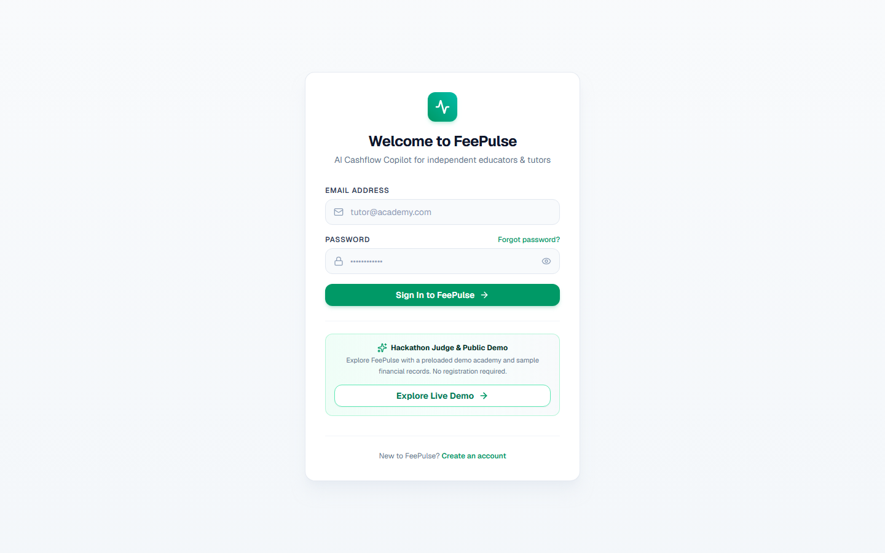
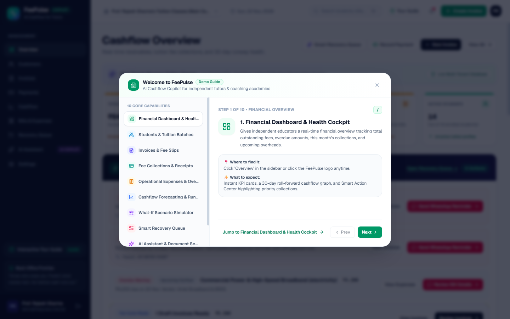

---

## 8. Limitations & Commercial Roadmap

To ensure transparent and accurate judging, here is an explicit distinction between currently implemented features and future roadmap items:

### Currently Working in Production
- Multi-tenant authentication, session management, and business configuration.
- Student roster with contact info, tuition batches, and individual ledgers.
- Invoicing engine with draft/sent states, line items, and printable slips.
- Partial and full payment tracking with idempotent duplicate detection and receipts.
- Operational overhead management with recurring frequency tracking.
- Deterministic 30/60/90-day cashflow roll-forward engine and runway chart.
- Interactive What-If Scenario Simulator with real-time comparative lines.
- Smart Recovery Queue with urgency ranking based on aging and broken promises.
- Multimodal document receipt extraction and WhatsApp promise parsing.
- 1-click WhatsApp message deep links (`https://wa.me/`) for manual tutor review.

### Proposed Commercial Packaging & Roadmap
- **Automated WhatsApp Cloud API Bot:** Inbound webhook integration allowing tutors to forward parent messages directly to an automated WhatsApp business number.
- **Dynamic BharatQR / UPI Deep Linking:** Payment gateway integration (Razorpay / Cashfree) generating unique dynamic QR codes encoding the exact invoice balance.
- **Multi-Staff RBAC:** Differentiated role-based access control for Academy Owners (full P&L visibility) versus Assistant Tutors (attendance and fee entry only).
- **Tally / Accounting CSV Export:** Formatted accounting export for tax filing.

---

## 9. CodeBenders Hackathon 2026 Submission Information

* **Project Title:** FeePulse — AI Cashflow Copilot for Independent Tutors
* **Track / Problem Statement:** Problem Statement 1 — *Small Business Operations: The One-Person Back Office*
* **Live Deployment URL:** [https://feepulse.vercel.app](https://feepulse.vercel.app)
* **GitHub Repository:** [https://github.com/DhanushPadarthi/codebenders](https://github.com/DhanushPadarthi/codebenders)
* **Target Audience:** Independent home tutors, private coaching institutes, and test-prep educators in India.

### Honest Tooling & Development Disclosure
* **Repository Origin:** The repository was initialized and set up within the CodeBenders workspace environment.
* **Engineering Execution:** Core application engineering, refactoring, and automated test suite creation were conducted with assistance from Code Benders.
* **Zero Fabricated Claims:** All test results, market assumptions, and architectural descriptions represent verified codebase implementations.

---

## 10. Automated Test Suites & Quality Assurance

FeePulse includes comprehensive automated test suites covering financial calculations, concurrency, security, and UI flows:

```bash
# 1. Cashflow Projection Engine (11/11 Passed)
node --experimental-strip-types scripts/test-cashflow-engine.mjs

# 2. Smart Recovery Queue Algorithm (8/8 Passed)
node --experimental-strip-types scripts/test-recovery-queue.mjs

# 3. AI Security & Guardrails (16/16 Passed)
node --experimental-strip-types scripts/test-ai-assistant.mjs

# 4. PostgreSQL 17 Financial Integrity & Concurrency (6/6 Passed)
node scripts/test-financial-integrity-pglite.mjs

# 5. Full Application Lint & Build Check
npm run lint
npm run build
```

---

## 11. Local Development Setup

To run FeePulse locally:

```bash
# 1. Clone the repository
git clone https://github.com/DhanushPadarthi/codebenders.git
cd feepulse

# 2. Install dependencies
npm install

# 3. Set up environment variables (.env.local)
NEXT_PUBLIC_SUPABASE_URL=your_supabase_url
NEXT_PUBLIC_SUPABASE_ANON_KEY=your_supabase_anon_key
SUPABASE_SERVICE_ROLE_KEY=your_service_role_key
GROQ_API_KEY=your_groq_api_key
GROQ_TEXT_MODEL=llama-3.3-70b-versatile
GROQ_VISION_MODEL=qwen-2.5-32b

# 4. Run the development server
npm run dev
```

Open [http://localhost:3000](http://localhost:3000) to start exploring.
